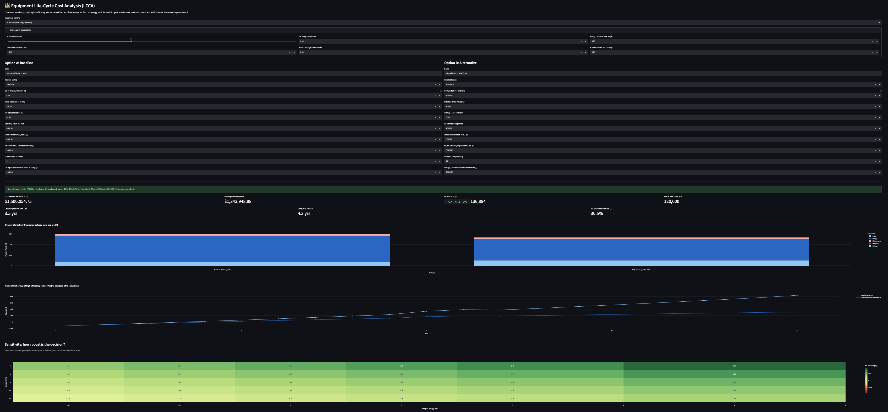
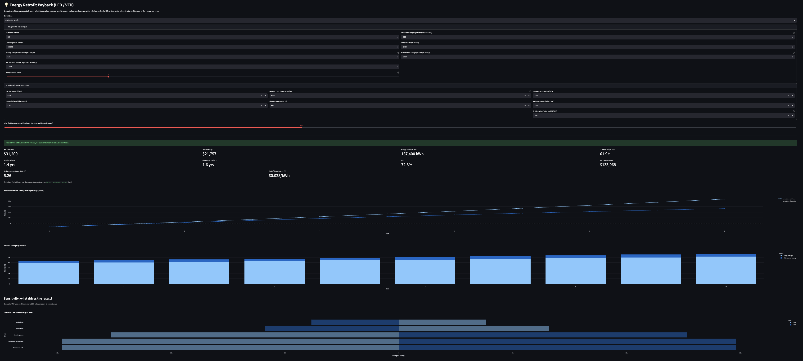
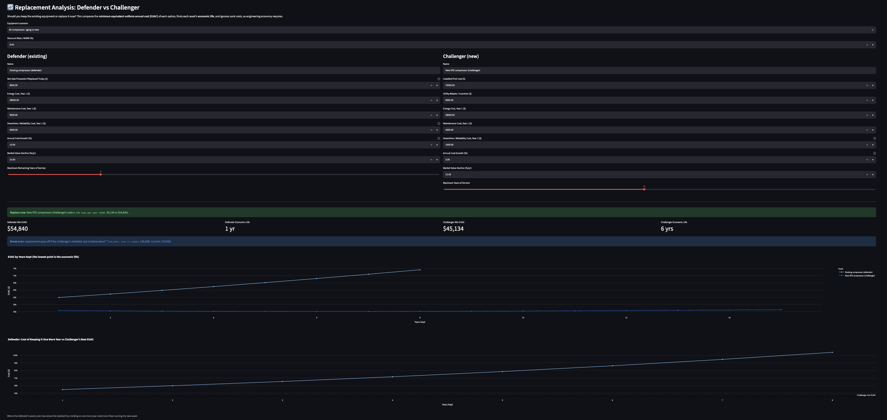

# Engineering Economy & Facilities Decision Calculator

**Interactive decision tools for capital-equipment, energy and replacement questions, built with Python, Pandas, Plotly and Streamlit.**

🔗 **[Live app](https://finance-calc-6ftv2fce96mnlceom7fk33.streamlit.app/)**

<!-- CI badge: uncomment after uploading .github/workflows/tests.yml

-->

---

## The problem

Capital decisions in plants and facilities are often made on **first cost**: the cheaper chiller, the old compressor that "still runs", the lighting that hasn't been touched in 15 years. The real cost shows up later in energy, demand charges, maintenance, downtime and resale value.

This app puts those costs on a common time-value-of-money basis so an engineer can answer, with numbers:

- Which equipment option has the lowest **total cost of ownership**?
- Does an efficiency retrofit clear our **hurdle rate**, and how fast does it pay back?
- Should we **keep the old machine or replace it now**, and at what purchase price does the answer flip?

## What it covers

| Module | Decision it supports | Methods and key outputs |
|---|---|---|
| **Equipment Life-Cycle Cost (LCCA)** | Standard vs high-efficiency chiller, compressor or any equipment | Present worth of energy (with demand charges and escalation), maintenance, overhaul, rebate and salvage; EUAC; incremental payback, discounted payback and IRR; discount-rate × energy-price sensitivity heatmap |
| **Energy Retrofit Payback (LED / VFD)** | Lighting and variable-frequency-drive upgrades | kWh and demand savings, rebates, simple and discounted payback, NPW, IRR, savings-to-investment ratio (SIR), cost of saved energy, CO₂ avoided, tornado sensitivity chart; VFD power from speed via the affinity laws |
| **Replacement Analysis (Defender vs Challenger)** | Keep or replace existing equipment | EUAC by years kept, economic life, marginal cost of keeping the defender one more year, break-even price for the challenger; sunk costs ignored |
| **Project Evaluation** | Single capital project vs MARR | NPW, EUAW, future worth, salvage value, cash-flow diagram |
| **Depreciation** | Book value and tax depreciation | Straight-line, double-declining balance (switches to straight-line, never below salvage), MACRS half-year convention for 3, 5, 7, 10 and 15-year property |
| **Loans, Mortgage & Auto** | Financing and vehicle decisions | Amortization schedule, effective APR including fees, **auto buy vs lease** on a present-worth basis with resale-value sensitivity |
| **Savings & Fixed Deposit** | Compound growth | APR vs APY handled correctly, effective annual yield |
| **Bank Rate Reference Table** | Context | Static illustrative rates (clearly labelled as not live) |

## Screenshots

<!-- Add images to docs/screenshots/ with these names, then these links will render -->

| LCCA sensitivity heatmap | Retrofit tornado chart | Replacement verdict |
|---|---|---|
|  |  |  |

## Worked examples (illustrative defaults)

These are the numbers the app opens with. They are plausible placeholders, not field data.

**Chiller LCCA.** A high-efficiency chiller costs more up front but uses 50 kW less at full load. Over a 20-year study at 8%, with energy and maintenance escalating at 3%, its present-worth life-cycle cost is lower, and the sensitivity heatmap shows whether that still holds if energy prices or the discount rate move.

**Compressor replacement.** An aging fixed-speed compressor (EUAC about $54.8k/yr including downtime and rising maintenance) against a new VFD unit (EUAC about $45.1k/yr): replace now. The break-even view shows how much more the new unit could cost before the answer reverses.

**LED high-bay retrofit.** 120 fixtures going from 0.46 kW to 0.15 kW each, 4,500 h/yr, saves about 167,000 kWh/yr. The module reports payback, IRR, SIR, and the cost of each saved kWh to compare with the tariff.

## Methods

All formulas live in [`modules/calc.py`](modules/calc.py) as pure functions with no Streamlit code, so they can be tested on their own.

- **Interest factors:** (P/A), (A/P), (P/F), (F/P), with the zero-rate case handled
- **Life-cycle cost:** PW = Σ Cₜ / (1+i)ᵗ over the study period; EUAC = PW × (A/P, i, n); energy and maintenance escalate from year 2
- **Retrofit metrics:** NPW; IRR by bisection; payback with within-year interpolation; SIR = PW(savings) / net investment; cost of saved energy = net cost × (A/P) / annual kWh saved
- **Affinity laws:** P ∝ N³, so a pump at 80% speed draws about 51% of full-speed power before drive losses
- **Replacement:** EUAC for each retention period k, with market value falling at a constant rate; marginal cost of year k = MVₖ₋₁(1+i) − MVₖ + operating costₖ; economic life = k with minimum EUAC
- **Auto lease:** money factor = APR / 2400; payment = depreciation + finance charge (+ tax); buy and lease compared by net nominal cost and by present worth at the user's opportunity cost of cash
- **Depreciation:** MACRS percentages from IRS Publication 946, Table A-1 (half-year convention)

## Verification

- **48 unit tests** (`pytest`) run against textbook values (for example (P/A, 8%, 10) = 6.7101), closed-form cross-checks (escalating-cost present worth), and internal-consistency properties (the present worth of marginal costs equals the present worth of total cost; IRR drives NPW to zero; MACRS tables sum to 100%)
- Regression tests for previously fixed bugs, such as declining-balance depreciation falling below salvage
- Every screen is exercised programmatically across its scenarios and edge cases before release
- GitHub Actions workflow runs the test suite on each push

```bash
pip install -r requirements-dev.txt
pytest -q
```

## Project structure

```
app.py                     Streamlit entry point and navigation
modules/
  calc.py                  Pure calculation functions (all the engineering math)
  lcca.py                  Life-cycle cost screen
  retrofit.py              LED / VFD retrofit screen
  replacement.py           Defender vs challenger screen
  project_worth.py         NPW / FW / EUAW screen
  depreciation.py          SL, DDB, MACRS screen
  loans.py                 Loans, mortgage, auto, buy vs lease
  savings.py               Compound growth screen
  benchmarks.py            Static rate reference table
  common.py                Currency formatting
tests/                     pytest suites for the formulas
```

## Run locally

```bash
git clone https://github.com/GP26902/Finance-Calc.git
cd Finance-Calc
pip install -r requirements.txt
streamlit run app.py
```

## Assumptions and limitations

- Analyses are **before-tax**, over a common study period, with constant annual escalation rates
- Defaults are **illustrative**; replace them with vendor quotes, measured power draw and your utility tariff
- Demand charges are applied to the kW reduction using a coincidence factor; real tariffs (ratchets, time-of-use, tiered rates) are more complex
- Market value is modelled as a constant percentage decline per year
- Vehicle comparisons exclude insurance, maintenance, registration and wear-and-tear charges
- Bank rates are a static snapshot, not live data

## Part of a larger portfolio

This is one of several industrial and mechanical engineering analytics tools I'm building. Related projects: *Financial Sankey Dashboard* and *Manufacturing Operations Command Center (SPC)*. <!-- add repo links -->

**Built by GP** · M.S. Industrial Engineering, University of Houston · <!-- add LinkedIn link -->
